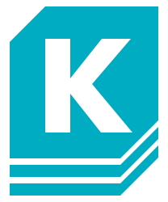

<div align="center">

<!-- TODO: Replace with hero screenshot once the first native build is ready -->
<!--  -->



# KyanDB

**A free, native database workbench built in pure Go.**

PostgreSQL · MySQL / MariaDB · SQLite

Just for fun.

[](#database-roadmap)
[](#development)
[](#architecture)
[](LICENSE)

[**Why KyanDB**](#why-kyandb) ·
[**Workflows**](#core-workflows) ·
[**Architecture**](#architecture) ·
[**Database Roadmap**](#database-roadmap) ·
[**Development**](#development)

**English** | [简体中文](README.zh-CN.md)

</div>

---

## What is KyanDB

KyanDB is an open-source, GPU-accelerated desktop database client for macOS, Windows, and Linux. Written in pure Go with zero CGO and powered by [`mygo`](https://github.com/egoist/mygo)'s native GPU UI, KyanDB aims to give developers and operators a fast, calm, high-density database workbench without Electron's memory overhead or JVM cold starts.

It starts with first-class support for **PostgreSQL**, **MySQL / MariaDB**, and **SQLite**, built on an extensible pure-Go engine layer so additional engines can be added cleanly over time.

> [!NOTE]
> KyanDB is in active early development. The sections below describe the target product design and milestone plan.

---

## Why KyanDB

- **Native GPU UI, zero Electron, zero JVM.** Built in pure Go on top of `mygo` (Metal on macOS, Direct3D 11 on Windows, OpenGL on Linux) for fast startup, low memory footprint, and smooth virtual scrolling over large result sets.
- **Bastion & SSH tunnel ready.** First-class SSH tunneling (`ProxyJump`, key/passphrase/agent auth) and OS keychain credential isolation built directly into the connection layer—designed alongside [OxideTerm](https://github.com/AnalyseDeCircuit/oxideterm) for real private-network workflows.
- **Safe by default for production.** Color-coded environment tags (`dev` / `staging` / `prod`), runtime-enforced read-only locks, staged inline edits with reviewable SQL diffs before committing, and local audit trails.
- **AI & MCP ready without exposing credentials.** Optional local loopback MCP server for external coding agents with connection-scoped leases and human approval gates for write/DDL statements.
- **Local-first & open source.** Licensed under GPL-3.0.

---

## Core workflows

### Data browser & staged inline editing
- Virtualized table grid built for wide schemas and large result sets.
- Quick filter, multi-column sort, JSON/text cell inspector, and foreign-key navigation.
- **Staged changes**: edit cells or delete rows in a local draft, inspect the exact generated SQL diff, and commit or discard inside a single transaction.

### SQL editor
- Multi-tab query workspace with syntax highlighting, schema-aware completion, and formatted results.
- Run current statement or selection, inspect `EXPLAIN` plans, and search local query history.
- Export results and tables to CSV, JSON, JSONL, or SQL.

### Connection security & environment guardrails
- **Built-in SSH tunnels** supporting private keys, SSH agent, passphrases, and multi-hop jump hosts.
- **OS Keychain storage** via `mygo.Secrets`—plain settings files store only non-sensitive metadata and opaque key references.
- **Environment tags** (`dev` / `staging` / `prod`) with visual chrome accents and runtime-enforced read-only protection for sensitive clusters.

### Local MCP integration
- Local loopback **MCP (Model Context Protocol)** server for Claude Code, Codex, Cursor, and other external agents.
- **Connection-scoped leases**: grant read-only schema and query access to a specific connection for a bounded time window.
- **Human-in-the-loop write gates**: mutations and DDL statements pause for explicit SQL review and approval in KyanDB, with full local audit logging.

---

## Architecture

| Layer | Choice | Why |
| --- | --- | --- |
| **Language** | Pure Go (`CGO_ENABLED=0`) | Fast compilation, clean concurrency, single-binary cross-platform builds |
| **Desktop & GPU UI** | [`egoist/mygo`](https://github.com/egoist/mygo) | Native GPU rendering (Metal / Direct3D 11 / OpenGL), system menus, dialogs |
| **Database Drivers** | Pure-Go native drivers (`pgx`, `go-sql-driver/mysql`, `modernc.org/sqlite`) | Zero C toolchain or external runtime dependencies |
| **Credentials** | OS Keychain (`mygo.Secrets`) | Keeps secrets out of plaintext config and external agent contexts |
| **Agent Bridge** | Local Loopback MCP Server | Safe, auditable AI workflows without exposing raw database credentials |

See [`docs/ARCHITECTURE.md`](docs/ARCHITECTURE.md) for package boundaries, dependency rules, and lifecycle ownership.

> **Why the name "KyanDB"?**
> From Greek *kyanos* (deep blue) and **Kyanite** (Al₂SiO₅), a blue aluminosilicate oxide mineral—a quiet nod to Go's blue palette and a sibling in spirit to [OxideTerm](https://github.com/AnalyseDeCircuit/oxideterm).

---

## Development

> Prerequisites: Go 1.24+ and the `mygo` CLI.

```bash
git clone https://github.com/AnalyseDeCircuit/KyanDB.git
cd KyanDB
go test ./...
go run .
```

---

## License

KyanDB is free and open-source software licensed under the [GNU General Public License v3.0](LICENSE).
