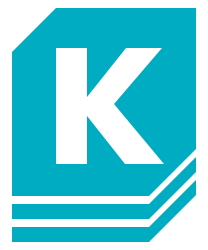

<div align="center">

<!-- TODO: 首个原生版本跑通后替换为真实界面截图 -->
<!--  -->



# KyanDB

**一款纯 Go 原生、免费开源的现代数据库工作台。**

PostgreSQL · MySQL / MariaDB · SQLite

Just for fun · 纯粹为好玩而做

[](#数据库支持路线表)
[](#本地开发)
[](#技术架构)
[](LICENSE)

[**为什么做 KyanDB**](#为什么做-kyandb) ·
[**核心工作流**](#核心工作流) ·
[**技术架构**](#技术架构) ·
[**数据库路线**](#数据库支持路线表) ·
[**本地开发**](#本地开发)

[English](README.md) | **简体中文**

</div>

---

## 什么是 KyanDB

KyanDB 是一款面向 macOS、Windows 与 Linux 的开源原生数据库客户端。它基于纯 Go（零 CGO）与 [`mygo`](https://github.com/egoist/mygo) 原生 GPU 界面框架构建，希望给开发者和运维人员提供一个启动快、内存低、信息高密度且克制顺手的数据库工作台——告别 Electron 的内存负担与 JVM 的漫长冷启动。

项目首期聚焦 **PostgreSQL**、**MySQL / MariaDB** 与 **SQLite**，底层通过可扩展的纯 Go 引擎抽象设计，后续可按需接入更多数据源。

> [!NOTE]
> KyanDB 目前处于早期活跃开发阶段，以下内容为目标产品设计与里程碑规划。

---

## 为什么做 KyanDB

- **纯 Go 原生 GPU 界面，告别 Electron 与 JVM**：基于 `mygo`（macOS Metal / Windows Direct3D 11 / Linux OpenGL），冷启动快、常驻内存低，大结果集虚拟滚动流畅。
- **原生 SSH 跳板机隧道**：内置多跳 SSH 隧道（`ProxyJump`、私钥 / 口令 / SSH Agent 认证）与系统钥匙串凭据隔离，与 [OxideTerm](https://github.com/AnalyseDeCircuit/oxideterm) 一脉相承，开箱应对内网与堡垒机环境。
- **默认面向生产安全**：环境色标（`dev` / `staging` / `prod`）、运行时强制只读锁、行内修改先入草稿再预览 SQL Diff 提交，以及本地操作审计记录。
- **面向 AI 与 MCP，但不交出数据库密码**：可选的本机回环 MCP 服务，支持按连接授予临时只读租约，写操作与 DDL 需在客户端内审阅 SQL 后人工放行。
- **本地优先、开源**：采用 GPL-3.0 协议。

---

## 核心工作流

### 数据浏览与暂存式行内编辑
- 面向宽表与大结果集的虚拟化数据网格。
- 快速筛选、多列排序、JSON/长文本单元格详情抽屉与外键跳转。
- **暂存变更**：修改单元格或删除行默认进入本地草稿，先核对生成的精确 SQL Diff，确认后在单事务内统一提交或放弃。

### SQL 编辑器
- 多标签查询工作区，支持语法高亮、基于 Schema 的自动补全与结果集展示。
- 支持执行当前语句或选中片段、查看 `EXPLAIN` 执行计划与检索本地查询历史。
- 支持将查询结果或整表导出为 CSV、JSON、JSONL 或 SQL。

### 连接安全与环境防护
- **内置 SSH 隧道**：支持私钥、SSH Agent、口令以及多级跳板机。
- **系统钥匙串存储**：通过 `mygo.Secrets` 保存密码与私钥，明文配置文件仅记录非敏感元数据与不透明引用。
- **环境标签**：通过 `dev` / `staging` / `prod` 视觉标识区分环境，并在运行时层面对敏感实例执行只读保护。

### 本地 MCP 集成
- 提供仅限本机回环的 **MCP（Model Context Protocol）** 服务，可直接对接 Claude Code、Codex、Cursor 等外部代理。
- **连接级临时租约**：仅向外部代理开放指定连接、指定时长内的只读 Schema 与查询权限。
- **写操作人工审批门禁**：任何变更或 DDL 语句都会暂停并弹出精确 SQL 预览，经人工确认后才执行，并全程记录本地审计日志。

---

## 技术架构

| 层级 | 选型 | 理由 |
| --- | --- | --- |
| **开发语言** | 纯 Go（`CGO_ENABLED=0`） | 编译极快、并发清晰、跨平台单二进制无痛构建 |
| **桌面与 GPU UI** | [`egoist/mygo`](https://github.com/egoist/mygo) | 原生 GPU 渲染（Metal / Direct3D 11 / OpenGL）、系统菜单与对话框 |
| **数据库驱动** | 纯 Go 原生驱动（`pgx`、`go-sql-driver/mysql`、`modernc.org/sqlite`） | 零 C 工具链依赖，无外部运行时包袱 |
| **凭据安全** | 系统钥匙串（`mygo.Secrets`） | 凭据不落盘明文，不进入外部代理上下文 |
| **代理桥接** | 本机回环 MCP 服务 | 安全、可审计的 AI 协作体验，同时严格隔离原始凭据 |

详细的包边界、依赖规则与生命周期所有权见 [`docs/ARCHITECTURE.md`](docs/ARCHITECTURE.md)。

> **为什么叫 KyanDB？**
> 词源来自希腊语 *kyanos*（深蓝）与蓝色铝硅酸盐氧化矿物 **Kyanite（蓝晶石，Al₂SiO₅）**——呼应 Go 语言的蓝色基调，也是 [OxideTerm](https://github.com/AnalyseDeCircuit/oxideterm) 的姊妹项目。

---

## 本地开发

> 环境要求：Go 1.24+ 与 `mygo` CLI。

```bash
git clone https://github.com/AnalyseDeCircuit/KyanDB.git
cd KyanDB
go test ./...
go run .
```

---

## 开源协议

KyanDB 基于 [GNU General Public License v3.0](LICENSE) 协议免费开源。
